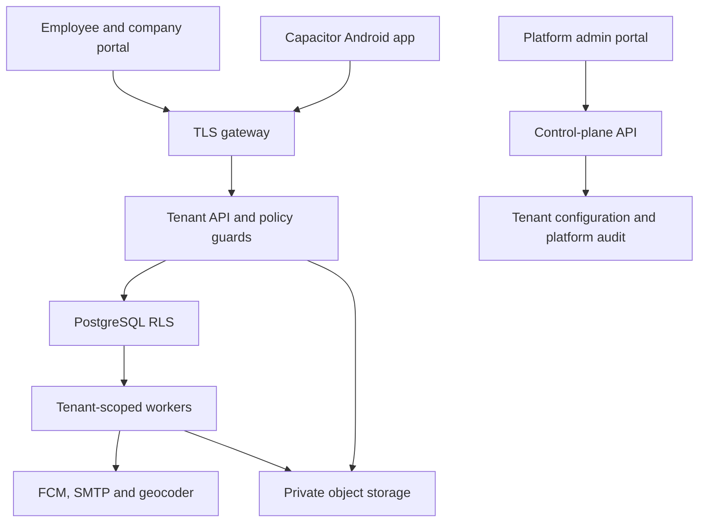

# Telite CRM — Architecture

**Phase 1 design baseline · 14 November 2026 · Awaiting approval for Phase 2.**
Repository inspection: `NaveenSabapathi/telite_crm` was empty. This package specifies a greenfield system. It contains reference SQL and documentation, not a running application or a production-readiness certification.

## 1. Decisions

| Area | Decision and reason |
|---|---|
| Backend | Python FastAPI, Pydantic request validation, SQLAlchemy 2 and Alembic; modular monolith with explicit domain services, not microservices |
| Database | PostgreSQL in development, CI and production; row-level security (RLS), composite tenant FKs, transactional outbox. SQLite is excluded from the SaaS deployment because it cannot reproduce PostgreSQL RLS |
| UI | React + TypeScript + Vite; compiled Tailwind; no runtime CSS CDN; route-split employee/admin views. No Next.js server needed for this authenticated app |
| Android | Capacitor bundling local web assets; native adapters for location, camera, scanner, push and lock. No remote `server.url` in release builds |
| Jobs | Celery workers + Redis broker; one scheduler leader enqueues due work. PostgreSQL outbox and unique job keys provide recovery after broker failure |
| Live updates | Authenticated SSE with durable tenant/user-authorized event replay, fetch streaming for bearer clients; polling fallback |
| Files | Private S3-compatible object storage; quarantine, validation, scan, controlled downloads and retention |
| Reports | Server-generated PDF using escaped templates and CSV; SMTP with TLS; no arbitrary external resource fetching by PDF renderer |
| Deployment | Reverse proxy/TLS, API, worker, scheduler, PostgreSQL, Redis; DB/Redis private network only; isolated control-plane credentials |
| Initial defaults | Asia/Kolkata tenant timezone, INR, one currency per tenant, report on 1st at 08:00 local, no self-serve billing in mobile release |

Exact dependency versions will be pinned and compatibility-tested in the implementation phase. Capacitor documentation reviewed here is v8; that does not establish every third-party plugin's compatibility.

## 2. Trust boundaries



Control plane may provision tenants, feature flags, limits, credentials and health aggregates. It does not expose a combined customer/ticket search. Platform identities live in `control.platform_admins`, separate from tenant `app.users`; a company admin can never set a SUPER_ADMIN role on a business user. Global control tables are `tenants`, `platform_admins`, `platform_sessions`, `platform_audit`; `tenant_features` carries tenant_id. Every business table in `app` carries tenant_id.

### Request isolation protocol

1. Validate access token signature, issuer, audience, expiry and session revocation; browser session alternatives use CSRF-protected cookies. Never trust token claims without checking current user activity/token version and tenant status/validity.
2. Resolve canonical tenant from authenticated identity. A login slug/subdomain selects a tenant but never establishes authority; reject host/identity mismatches. Accept only registered hostnames, not arbitrary forwarded headers. Body/query tenant_id is forbidden on business endpoints.
3. Create immutable TenantContext containing tenant UUID, user UUID, current role, scopes and request ID. Fail before opening a repository when context is missing. SQLAlchemy query/flush hooks reject missing context and append tenant predicates to ORM reads/writes; Core SQL must use reviewed tenant-bound repositories.
4. Begin a DB transaction; execute parameterized `SELECT set_config('app.tenant_id', :tenant_id, true)`. Set this in *every* transaction, including worker tasks. Transaction-local settings disappear at completion; no persistent SET on pooled connections.
5. RLS `USING` and `WITH CHECK` applies to all app tables. A runtime connection is neither owner nor superuser, has NOBYPASSRLS and no DDL/TRUNCATE privileges. `FORCE ROW LEVEL SECURITY` is enabled. Missing context also raises through `app.current_tenant()`; the API guard is essential since an empty-table query may never evaluate a row predicate.
6. Business FKs are `(tenant_id, referenced_id)`, making an A-ticket → B-customer reference invalid even if both UUIDs exist. Identity-changing updates are rejected. RBAC and record assignment checks are additional to tenant isolation.
7. Commit domain change, audit entry and outbox event atomically. Return only an allowlisted response DTO, not an ORM object with accidental relationships.

No request-controlled `is_super_admin` database variable and no shared RLS bypass pool. Super-admin operations touching tenant rows must select one target tenant explicitly, record a reason and use its scoped context. Control-plane service gets restricted provisioning privileges; separate migration role owns DDL. Access to platform-wide health uses sanitized aggregates, not raw business records. Phase 2 must implement narrow control routines for checking tenant status, quota reservations and authentication bootstrap. Normal API credentials do not receive global SELECT on control identities or arbitrary tenant update grants.

RLS is defense in depth, not protection against a compromised API credential that can set arbitrary context. Prevent SQL injection, restrict secrets and network paths, and test every data access channel.

### Login and provisioning bootstrap

Tenant slug is resolved using an allowlisted control function returning only tenant ID/status, not tenant records. Authentication then opens an explicitly scoped transaction to find normalized email. Login errors are generic. Company creation transaction inserts tenant/features, first branch, shift and admin; activates only after complete setup. Generate a short-lived, single-use invitation token; never email a permanent password. Employee-limit enforcement locks the tenant quota row for create/reactivate/invite acceptance. Initial admin counts toward the employee limit. Last active company admin cannot be disabled, deleted or demoted before replacement.

## 3. Authentication and authorization

Web: short-lived access token in memory; rotating refresh credential in Secure HttpOnly SameSite cookie at the web origin; CSRF token + Origin check for cookie-authenticated writes, including refresh/logout. Native: short-lived bearer in memory, rotating refresh credential encrypted using Android Keystore-backed storage. Never store refresh secrets in localStorage, IndexedDB or Capacitor Preferences. Access token default 10 minutes, refresh family 14 days with reuse detection and revocation. Password reset, suspension and role changes revoke sessions immediately via server-side checks; SSE closes on revocation.

Separate platform token audience and routes; mandatory MFA for platform administrators, supported/required-by-policy MFA for company admins. Argon2id password hashes; rate-limit login/reset/OTP by tenant, account and IP. Platform reset triggers a single-use reset flow, not retrieval of existing credentials. Local biometric/device-credential unlock protects cached data; it never replaces server authorization. PIN fallback uses Android device credential where possible, not a reusable web PIN.

| Capability | Company admin | Dispatcher | Engineer | Sales | Platform admin |
|---|---|---|---|---|---|
| Employees, branch, shift, leave approval | Tenant-wide | No | Own request only | Own request only | Provision/reset only |
| Attendance and location | Tenant-wide with purpose | No staff map by default | Own | Own | No routine access |
| Ticket intake/assignment/estimates | All | All tenant tickets | Assigned work only | Linked won-lead ticket read | No routine access |
| Customers/assets | All | Service scope | Minimum assigned job fields | Assigned/queue lead scope | No routine access |
| Leads/quotes | All | No by default | No | Assigned + member queue | No routine access |
| Stock | All | Receive/reserve/RMA | Consume/return for assigned ticket | Read prices through quote API | No routine access |
| Reports and audit | All | Service receipt only | Own summaries | Own summaries | Platform audit/health only |
| Features, plan, suspension | Read own capabilities | No | No | No | Manage |

Feature checks are server-side on list/detail/write/export/jobs/SSE. `amc_tracker` requires `field_service_tickets`; disable is rejected until dependent feature is disabled. Disabling a module preserves its data, hides routine access and stops new jobs. Admin may request a documented export via controlled retention/export route. Background location additionally needs attendance, tenant flag, user consent and active travel session. Feature and permission changes invalidate capability caches.

## 4. Domain boundaries and transactions

`identity`, `tenancy`, `workforce`, `customers`, `service`, `inventory`, `sales`, `contracts`, `notifications`, `reports`, `privacy`, `audit`. Router → request DTO → policy → domain service → tenant repository. Routers cannot perform free-form ORM queries. DTOs reject unknown privileged fields. Async work includes tenant UUID + actor/system purpose; worker rechecks tenant active state, flag and eligibility before processing.

- Attendance insert + location evidence + audit + outbox is one transaction. Unique open-shift and shift-date constraints stop double taps. Corrections preserve original evidence.
- Ticket transition locks current row; expected version prevents stale/reassigned-device edits. Completion checks clean photo, notes, customer acceptance tied to the resolution version, mode and valid checkout for on-site work. Walk-in mode uses shop handover and does not require fictitious customer-site GPS.
- Stock reserve/consume locks part rows in UUID order and updates stock/reservation/ledger atomically. Reject negative stock; returns are compensating movements. Engineers cannot arbitrarily edit quantities/cost.
- Lead WON + ticket creation is atomic/idempotent; unique source lead prevents duplicate installation jobs. A lead represents one installation job in v1; split jobs require deliberate later extension.
- Record cash/UPI as collected but unverified until reconciled. A UPI screenshot/reference is not bank verification. Credit/warranty means no collection and must not inflate cash revenue. Full GST invoicing/accounting is outside v1; quotes and service receipts are not tax invoices.
- AMC generation locks schedule and creates occurrence `(tenant,schedule,due_date)` once, checking coverage and customer/asset consistency. RMA records preserve old and replacement serial history.

## 5. Offline, realtime and files

Mobile keeps minimal assigned-work cache and encrypted local drafts, namespaced by tenant/user. Browser PWA stores only minimal drafts with explicit risk disclosure on shared devices; auth responses and GPS/media are not service-worker cached. Logout, tenant switch, suspension and lock purge or lock cached data. Android cryptographic key must become unavailable when device credential changes; wipe app-owned data when session revoked on next contact.

Queue entry: client operation UUID, resource UUID, expected version, payload hash, captured_at and dependency IDs. Server idempotency scope `(tenant,user,route,key)`; same key/different payload → 409. Retain keys 30 days, accept queue submissions no older than 7 days, never replay expired entries automatically. Pending GPS punches/checkouts display **Pending verification**, not success. Offline location claims become review items, never authoritative payroll/site proof. Inventory consumption, approval, OTP verification and final completion require online validation. Photos may queue until upload finishes; ticket stays unresolved until required proof is clean.

SSE has per-tenant/per-user channels, max connection duration and reauthorization. Event payload contains resource ID + version, not full customer data; retrieval rechecks permissions. Replay cursor is scoped and bounded; expired cursors trigger a safe refresh. Redis notification is a wakeup, PostgreSQL event/outbox is durable. No public FCM tenant topics; direct device-token delivery only.

Files use server-generated tenant-prefixed keys and no public ACL. Reserve quota atomically before signed upload, verify actual bytes/type/magic/checksum, reject active SVG/HTML, strip unnecessary EXIF, scan before attachment. Upload expires and releases quota; abandoned objects are swept. Download authorizes parent ticket/report every time and issues a short-lived link. Never accept an arbitrary URL for server-side fetch. Avoid patient/payment/customer information in logs and push lock-screen text.

## 6. Operations and resilience

Container images non-root; TLS only; strict CORS origin allowlist; CSP without unsafe inline script; password/secrets via secret manager; no Docker socket mounted into app. Separate development, staging and production databases/buckets/FCM projects. API logs request IDs and safe error codes; omit passwords, tokens, OTPs, GPS, signatures and raw customer notes. Audit is append-only to runtime users; downstream immutable archival supports tamper evidence.

Proposed initial targets (to validate by load and restore drills): 99.5% monthly API availability; p95 list/action latency <750 ms excluding uploads/providers at 100 concurrent active users; first mobile shell <200 KB gzip JS budget, domain screens lazy-loaded; RPO ≤15 minutes using WAL archive, RTO ≤4 hours. Tenant quotas are commercial configuration, not a measured capacity promise.

Encrypted nightly base backups + continuous WAL to separate restricted storage; 30-day backup retention, monthly restore drill. A second database/replica is not a backup. Document tenant recovery into an isolated database, validate then import selected tenant data; never restore production in place casually. Object versioning and DB/object reconciliation cover media. Restore procedures replay deletion tombstones before re-enabling service. Alembic expand/contract migrations with preflight backup and backward-compatible rolling code; destructive migration has a recovery plan.

Health: public liveness returns no configuration; readiness checks DB/broker dependencies; privileged metrics show queue age, failures, storage and backup age. Alert on RLS/context failures, repeated OTP failures, stalled report jobs, dead-letter events and restore failures. Retry providers with bounded exponential backoff/jitter; outbox claims use SKIP LOCKED and leases. Delivery is at-least-once; SMTP acknowledgement ambiguity can cause duplicates, so reports include stable IDs and delivery status instead of promising exactly-once email.

## 7. Target folder structure

These paths are planned, not empty implementation stubs in this phase.

```text
backend/app/api/v1/             REST routers and DTOs
backend/app/core/               config, auth, TenantContext, permissions
backend/app/db/                 sessions, models, RLS hooks, repositories
backend/app/domains/            domain service packages
backend/app/jobs/               outbox, alerts, AMC, reports, retention
backend/migrations/            Alembic revisions and grants
backend/tests/                 PostgreSQL integration and policy tests
frontend/src/app/              router, shell, auth, capability context
frontend/src/features/         attendance, tickets, leads, admin
frontend/src/components/       accessible shared controls
frontend/src/platform/         web/native capability adapters
frontend/src/offline/          draft store and replay queue
frontend/public/               manifest, icons, public policy routing
frontend/android/              generated Capacitor Android project
infra/                         compose, proxy, backup and deploy scripts
docs/                          API, schema, privacy, acceptance and release docs
```

See [PRD](PRD.md), [database](docs/DATABASE.md), [API](docs/API.md), [edge cases](docs/EDGE_CASES.md), [report rules](docs/REPORTING.md), [Android plan](PLAYSTORE_DEPLOY.md), and [environment](.env.example).
