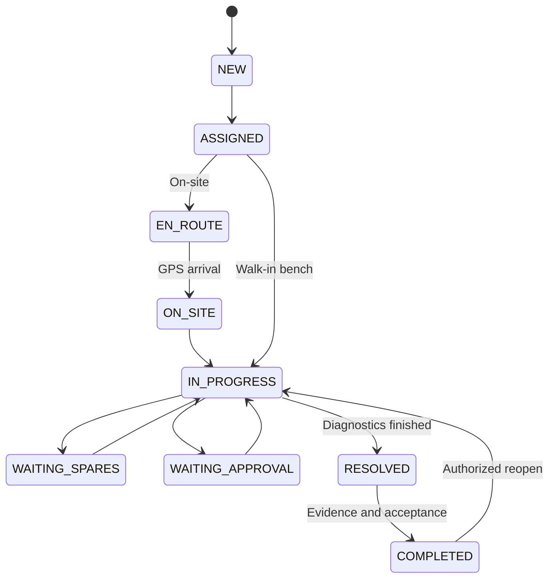

# Telite CRM — Product requirements

**Status:** Phase 1 proposed baseline, 14 November 2026. No application code implemented. Phase 2 starts only after owner confirmation.

## Product outcome

Provide hardware dealers and service firms one tenant-isolated workspace for staff attendance, customer hardware history, field dispatch, parts/RMA, AMC renewals and sales follow-ups. An engineer must be able to see the next job, capture evidence and finish service on a phone; an owner must be able to reconcile staff activity, collections and sales without mixing companies.

Primary users: SaaS owner, company admin, dispatcher/front office, engineer, sales rep. Initial industries: computers, CCTV, solar, networking, UPS and peripherals. A user has one role per tenant in v1; switching companies requires an explicit session/context switch. Role combinations and custom RBAC can follow after policy tests.

## Scope and user journeys

| ID | Requirement | Acceptance outcome | Phase |
|---|---|---|---|
| TEN-01 | Create tenant, slug, first branch/shift/admin invite | Atomic provisioning; invalid/duplicate slug rejected; no half-created active tenant | 2 |
| TEN-02 | Five requested module flags, extra background-location flag, quota, expiry, suspension | Server enforces all paths; active-user cap safe under simultaneous invites; suspended sessions rejected | 2 |
| IAM-01 | Login, refresh, logout, password reset, role and employee management | Rotation/reuse detection, generic auth errors, no plaintext passwords; last admin protected | 2 |
| ATT-01 | GPS punch in/out, device installation ID, optional selfie, reverse address | Office geofence validated; field punches labeled; no duplicate/open overlapping attendance | 3 |
| ATT-02 | Shift/grace/holidays, overnight shifts, leave/permissions | Snapshot schedule retained; pending request reviewed once; no self-approval or overlapping approved leave | 3–4 |
| ATT-03 | Pre-shift, late and missed checkout reminders | Tenant-local schedule; deduped; holiday/approved leave suppresses inappropriate alerts | 4 |
| SVC-01 | Walk-in/on-site intake, customer/asset/serial, condition/accessories, estimate and coverage | Serial camera scan plus manual entry; printable intake receipt/gate pass; duplicate warning | 3–4 |
| SVC-02 | Dispatch → travel → site → work → resolution → completion | Assigned engineer only; GPS evidence, clean after photo, notes, acceptance and mode mandatory | 3 |
| SVC-03 | Parts, quotes, RMA and warranty | No negative stock; quote revision approval bound to exact values; vendor dates and replacement history retained | 3–4 |
| AMC-01 | Covered assets, preventive schedule, renewal alerts | One ticket per scheduled occurrence; 30-day alert; no out-of-coverage generation | 4 |
| CRM-01 | Lead source, requirement, value, ownership/queue, activities/follow-up | Sales sees own/eligible queue; queue claiming atomic; overdue visible | 3 |
| CRM-02 | Pipeline and won conversion | Lost needs reason; won value recorded; won creates one installation ticket | 3 |
| CRM-03 | Site visit and quotation PDF | GPS evidence and customer-bound quote; server PDF totals match line values | 3–4 |
| MOB-01 | Shared responsive shell and offline drafts | Minimum 48px touch targets; pending/failed/conflict queue states; no silent loss | 3 |
| NTF-01 | Assignment, follow-up and shift alerts | Durable inbox plus FCM; permission refusal doesn't break work; stale tokens pruned | 4 |
| REP-01 | Tenant KPIs, staff map and downloadable custom report | Metrics use documented denominators; map shows timestamp/accuracy and stale label | 4 |
| REP-02 | Monthly PDF+CSV to verified company admins, test report | Correct local month; safe recipients; recoverable job; custom report ≤366 days | 4 |
| AND-01 | Capacitor Android release, lock, camera/scanner, push, location | Physical-device permission/lifecycle tests and signed AAB; background tracking separately gated | 5 |
| PRIV-01 | Privacy policy, disclosures, deletion request in app and public web | Requests authenticated/verified, secrets revoked, retention explained, associated data purged/anonymized | 2–5 |

### Attendance rules

Default one work shift per staff member per local shift date; split shifts are out of v1. Shift-date is the date the scheduled shift starts, even after midnight. Snapshot scheduled start/end/grace/work mode at punch-in. Office distance uses server-side geodesic calculation: require fresh fix (≤60 seconds) and accuracy ≤50 m by default; accept when distance + accuracy ≤ radius. Near-boundary/inaccurate fixes prompt retry or reviewed exception, never falsely claim guaranteed precision. Field mode allows remote location but retains risk indicators. Reverse-geocoder outage does not discard coordinates; populate address asynchronously. Client device time and mock flags are untrusted evidence; missing permission or unverifiable offline punch yields an explicit exception request, never fabricated coordinates.

No automatic fabricated punch-out. At scheduled end +30 minutes notify and flag incomplete. Admin correction requires reason and audit. Overtime is approved minutes beyond scheduled net work, not automatically payable time. Leave half-day/hour ranges prevent overlap and respect holidays. The monthly output is a payroll input summary, not statutory payroll or salary calculation.

### Service lifecycle

NEW → ASSIGNED requires active engineer. Authorized admin/dispatcher may cancel non-completed tickets with reason or reassign before completion; reassigning an active job invalidates the previous engineer's pending writes. Assignment is audited even if the lifecycle state stays unchanged. Reopen records reason and a new completion cycle; old evidence remains historical, fresh acceptance required. An on-site revisit after reopening requires a new arrival event. Customer not available is WAITING_APPROVAL with reason, not forced completion. Completion requires customer OTP **or** signature; customer acceptance must bind the actual ticket/resolution version. OTP verification is server-side, 5-minute validity, max 5 attempts, resend cooldown 60 seconds, rate cap per customer/ticket/IP. SMS provider is configurable and external cost/setup is required; signature is available without SMS.

Default SLA is elapsed time, snapshot by priority: urgent 4h, high 8h, normal 24h, low 72h (configurable business defaults, not contractual promises). Waiting reasons pause only if snapshot policy permits; log pause intervals and cap/admin-review long pauses. Site coordinates require dispatcher verification; missing customer coordinates produces a reviewed exception, never a bogus geofence success. Walk-in jobs use counter handover and bench workflow.

### Sales pipeline

NEW → CONTACTED → SURVEY_DONE → QUOTE_SENT → NEGOTIATION → WON / LOST. Admin may skip intermediate stages with reason, but WON needs value and installation details, LOST needs reason. Reopening a lost lead is audited. WON cannot silently create additional tickets on retries; returning a won lead to negotiation requires admin reversal and review of linked job/collections. Team queue users can view unassigned leads in their team and atomically claim; after claim only assignee/admin can edit. Quote approval binds revision, total, currency and customer identity; edits create a new revision and invalidate prior approval.

## Mobile and desktop interaction

Mobile <768px: five bottom tabs Today, Jobs, Leads (if enabled), Attendance, More; role/feature combinations may reduce count. Top card shows shift and next action. Cards show customer, area, priority, SLA and primary action. Swipes reveal actions but never finalize payment/completion without an explicit confirmation. 48px targets, visible focus, text+icon status (not color alone), strong contrast and sunlight-readable palette. Support screen readers, text scaling, keyboard entry and safe-area insets; photo/signature buttons offer retake/clear.

Desktop: collapsible sidebar, KPI strip, paginated/filterable tables, sticky column labels, saved filters. Bulk assignment/exports have a selection preview and per-record authorization/version checks; return partial failures per item, never silently skip. No unlimited all-row exports. Company admin map defaults to latest job/punch location with age/accuracy, not an implied continuous live tracker. Background travel mode is separately consented and visibly active; map stops receiving it off-shift and after travel end.

Offline UX: Draft → Queued → Syncing → Synced / Needs Review / Conflict / Failed. Keep entered form values after denied permission or network failure. Offer retry GPS/manual exception path; do not block access to non-location screens. Lock-screen pushes contain generic text. Native back navigation warns about unsaved drafts.

## Boundaries and assumptions

Includes stock/spares used for service, manual payment records, quotes and service receipts. Excludes full ERP stock purchasing, statutory GST invoices, bank reconciliation integration, salary disbursal, continuous covert tracking, biometric face recognition, guaranteed anti-spoofing, public customer self-service and in-app SaaS purchase. Barcode camera reads are fallible; operator confirms serial. Straight-line distance between check-ins is a lower-bound estimate, not exact road distance or automatic reimbursement proof.

Initial data retention proposal: location fixes 90 days; job photos/signatures 365 days; security/audit 365 days; backups 30 days; completed reports 365 days. These are configurable product defaults awaiting customer/privacy review, not legal retention requirements. Retained financial/service records should minimize personal data and explain any legitimate exceptions. Capture policy version and purge due dates in privacy operations. Purge raw location coordinates, accuracy and address using redacted_at while retaining a minimal event identity for historical foreign keys; delete media blobs and mark metadata DELETED. Service workers enforce the configured retention schedule and record the erasure decision.

## Release gates

Phase 1: complete design package and owner approval. Phase 2: runnable backend/control portal, migrations + explicit DB grants, two-tenant isolation tests, authentication/feature/quota tests. Phase 3: working employee workflows with network/permission/assignment-conflict tests. Phase 4: verified metrics, worker recovery, reports/SMTP/FCM integration tests with sandbox recipients. Phase 5: signed release artifact, physical-device tests, restore drill, privacy/Play review and documented operational ownership.

No phase is called production-ready solely because code compiles. Blocking evidence includes tenant isolation under a non-owner DB role, tested restore and migration, state-machine concurrency tests, permission-denial accessibility and actual Android release build verification.
