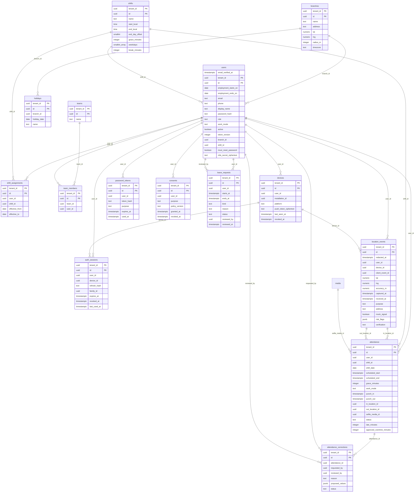
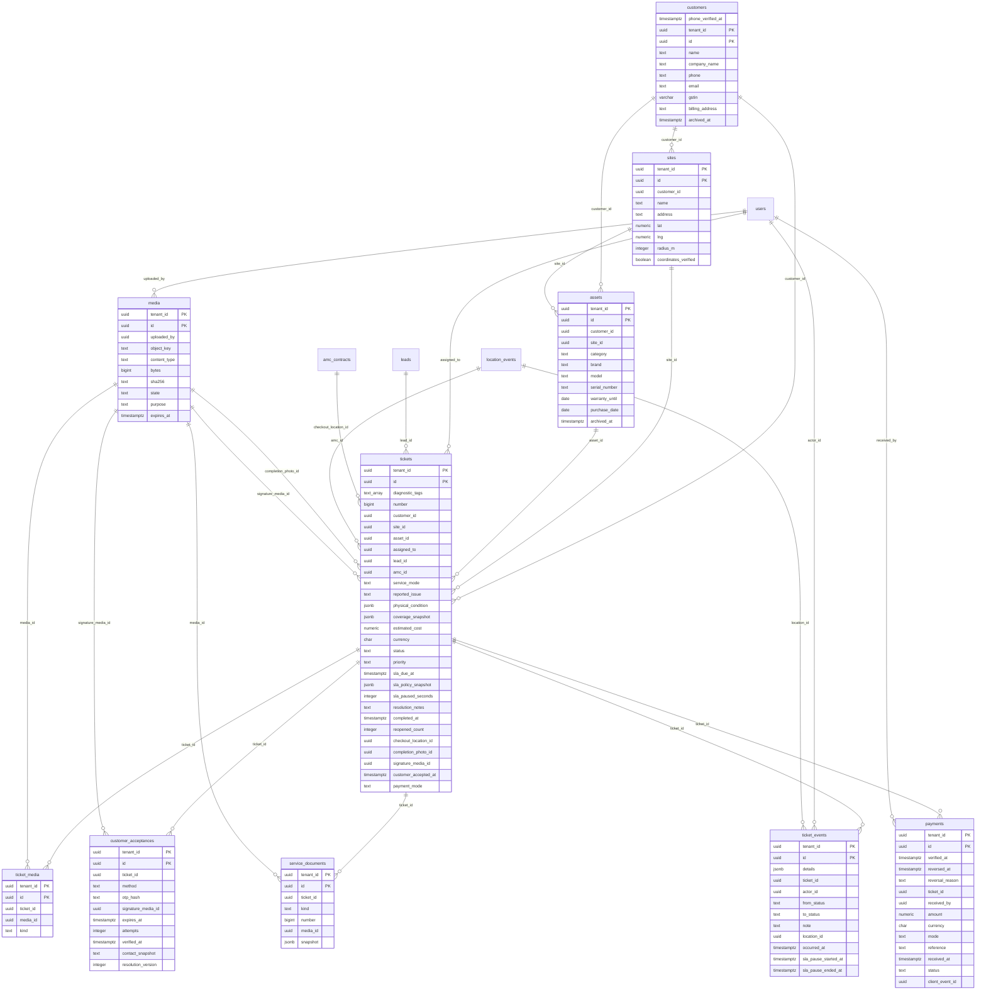
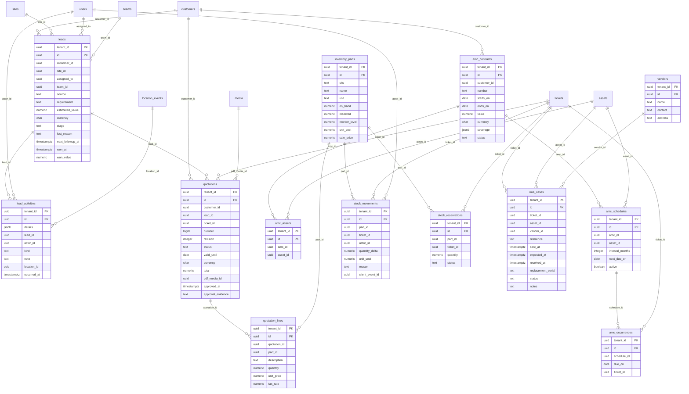
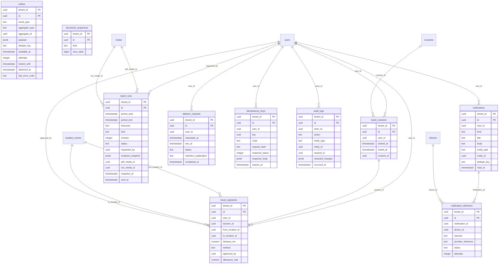
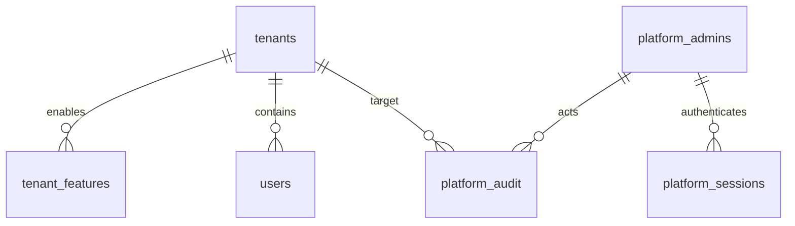

# Database model

Reference: [schema.sql](../db/schema.sql). Every app table has a composite `(tenant_id,id)` primary key, timestamps and version; every business foreign key includes tenant_id. Control-plane exceptions are explicitly listed in ARCHITECTURE.md.

## Workforce

## Customers and service

## Sales, contracts and stock

## Operations

## Control plane

## Enforcement boundaries

DDL enforces tenant FKs, immutable identity, RLS, open-attendance uniqueness, basic financial checks, and selected lifecycle invariants. Services must additionally enforce role/assignment permissions, overlapping leave/shift rules, customer/asset/AMC consistency, media ownership/purpose/clean status, legal transitions, OTP proof, active-user quotas and stock ledger balance. These are Phase 2–4 acceptance gates, not claims that the DDL alone enforces all business rules.

Serial numbers are searchable but deliberately not globally unique: incomplete or reused manufacturer serials occur. Confirm duplicate assets within a customer before creating; never merge automatically. Email uniqueness is per tenant. App user UUIDs have meaning only together with tenant UUIDs.

Date-times use timestamptz; business dates and local shift times are explicit. Amounts use decimal and an ISO currency snapshot, never floating point. No cascade deletes: retention/purge jobs delete dependent records in an audited order. A user tombstone can retain nonpersonal identifiers while credentials, profile fields and unneeded linked personal data are erased.

Polymorphic notification/outbox/audit entity IDs are intentionally not FKs; resolve through a fixed type allowlist under the same tenant and authorize the target before displaying. They never grant access. JSONB is limited to snapshots, checklists, redacted events and policy evidence, not core monetary or ownership relationships.
